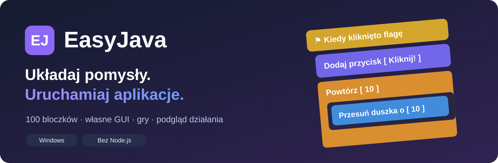
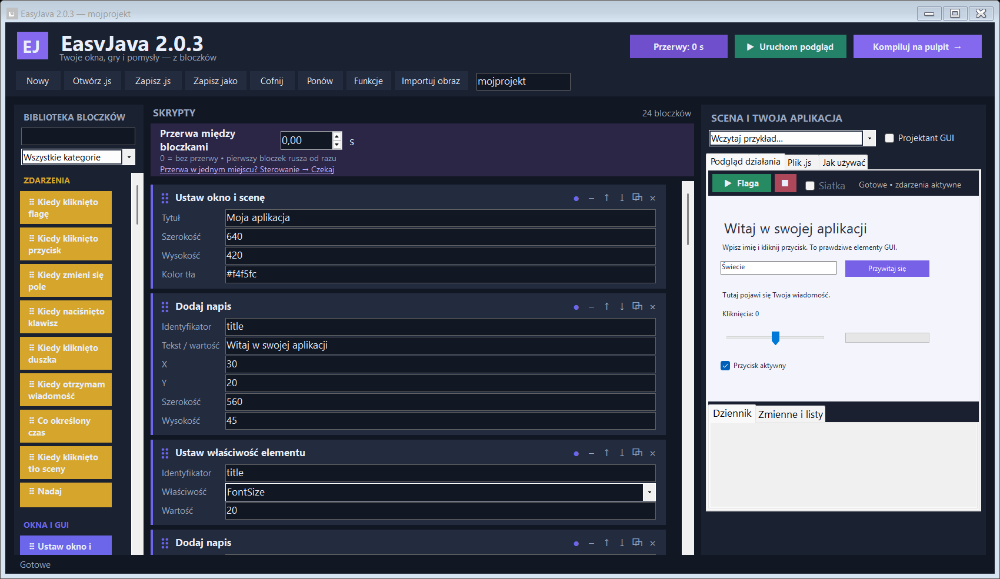
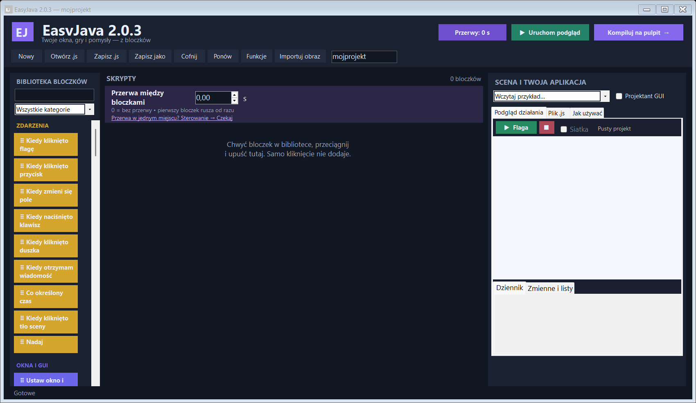
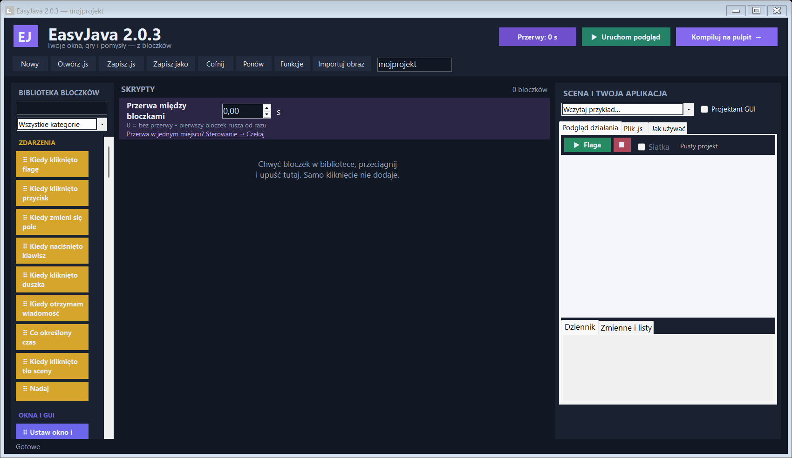

<p align="center">
  
</p>

<h1 align="center">EasyJava</h1>
<p align="center"><strong>Twój pomysł. Twoje bloczki. Twoja aplikacja.</strong></p>
<p align="center">Twórz okna, animacje i małe gry w Windows — z podglądem na żywo i jednym plikiem <code>.js</code>.</p>

<p align="center">
  
  
  
  
</p>

<p align="center">
  <a href="https://github.com/bajojajo214/easyjava/raw/refs/heads/main/download/easyjava.exe"><strong>⬇ Pobierz EasyJava.exe</strong></a>
  &nbsp; · &nbsp;
  <a href="https://github.com/bajojajo214/easyjava/raw/refs/heads/main/download/EasyJava-Windows.zip">Pobierz paczkę z przykładami</a>
  &nbsp; · &nbsp;
  <a href="docs/Instrukcja.txt">Instrukcja po polsku</a>
</p>

Chcesz zrobić własną aplikację z przyciskami albo grę sterowaną strzałkami? W EasyJava zaczynasz od pustego projektu, przeciągasz bloczki i od razu widzisz efekt. Gdy wszystko działa, klikasz **Kompiluj na pulpit** i uruchamiasz swój program dwuklikiem.

## Zobacz, co możesz zbudować



*Przykład wybrany ręcznie: własne okno, pole tekstowe, przycisk, suwak i pasek postępu. Normalny start aplikacji jest pusty.*

## Pobierz i zacznij

1. Pobierz **[easyjava.exe](https://github.com/bajojajo214/easyjava/raw/refs/heads/main/download/easyjava.exe)** lub **[paczkę ZIP](https://github.com/bajojajo214/easyjava/raw/refs/heads/main/download/EasyJava-Windows.zip)**.
2. Uruchom `easyjava.exe`. Dostaniesz **pusty nowy projekt**.
3. **Chwyć bloczek, przeciągnij go i upuść** w skryptach. Samo kliknięcie lub dwuklik niczego nie dodaje.
4. Kliknij **Uruchom podgląd** lub naciśnij **F5**.
5. Kliknij **Kompiluj na pulpit**. Gotowe — masz własny program!

Nie ma instalatora, logowania ani wymaganego połączenia z internetem. Potrzebujesz Windows z .NET Framework 4.x; uruchamianie wyeksportowanych projektów korzysta także z Windows Script Host. W tej wersji testy wykonano w Windows na .NET Framework 4.x.

Bezpośrednia kopia aplikacji jest również dostępna w **[download/easyjava.exe](https://github.com/bajojajo214/easyjava/raw/refs/heads/main/download/easyjava.exe)**.

**Aktualna wersja: 2.0.3.** Powyższe przyciski pobierania prowadzą do aktualnej aplikacji w gałęzi `main`. Numer wersji widać także w tytule okna aplikacji.

## Poprawka 2.0.3: przerwy zawsze pod ręką

Bezpośrednio nad bloczkami w obszarze **SKRYPTY** znajdziesz wyróżniony panel **Przerwa między bloczkami**. Wpisz liczbę sekund w widocznym polu — ustawienie zmienia się od razu. Możesz wybrać czas od **0 do 3600 sekund**, z dokładnością do dwóch miejsc po przecinku. **0** wyłącza dodatkowe przerwy.



Przycisk **Przerwy: 0 s** na górnym pasku otwiera także okno **Przerwy między bloczkami** z gotowymi wartościami **0 / 0,1 / 0,5 / 1 / 2 / 5 s**. W tym oknie potwierdź wybór przyciskiem **Zastosuj**. Po zmianie uruchom podgląd ponownie, a następnie zapisz `.js`, aby zachować ustawienie.

Pierwsze polecenie w skrypcie rusza od razu. Następne czeka wybrany czas od zakończenia poprzedniego. Ustawienie zapisuje się w projekcie `.js` i działa tak samo w podglądzie oraz gotowym programie.

Potrzebujesz przerwy tylko w jednym miejscu? Przeciągnij bloczek **Czekaj** z kategorii **Sterowanie** pomiędzy dwa polecenia i wpisz w nim czas. Znajdziesz go też, wpisując w wyszukiwarce **przerwa**, **pauza** lub **odstęp**. Jego czas dolicza się do przerwy ustawionej dla całego projektu. Dla samej pojedynczej pauzy pozostaw pole nad skryptami na **0**.

Pętle i warunki zachowują odstępy pomiędzy poleceniami w środku, bez podwójnych pauz. Komentarze i wyłączone bloczki nie dodają czasu. Każde nowe zdarzenie zaczyna od razu i ma własne odstępy, a **Stop** przerywa czekanie. Szczegóły wcześniejszej funkcji odstępów z wersji 2.0.2 znajdziesz w [historii zmian](CHANGELOG.md).

## Poprawka 2.0.1: chwyć i upuść

Bloczki z biblioteki dodajesz **wyłącznie przez przeciąganie i upuszczanie**. Pod kursorem widać przenoszony bloczek, a podświetlenie wskazuje miejsce wstawienia. Możesz upuszczać między kartami oraz do wnętrza pętli, warunku lub zdarzenia. Upuszczenie poza skryptami niczego nie zmienia.

Poprawka zapewnia też unikalne nazwy kolejnych elementów GUI oraz blokuje wkładanie deklaracji zdarzeń do wnętrza innych skryptów. [Lista zmian](CHANGELOG.md).

## Co jest w środku?

| Funkcja | Co z nią zrobisz |
| --- | --- |
| **100 bloczków w 11 kategoriach** | Połączysz zdarzenia, ruch, wygląd, logikę, obliczenia i wiele więcej. |
| **Własne GUI** | Dodasz napisy, przyciski, pola tekstowe, listy, suwaki, obrazy i paski postępu. |
| **Projektant GUI** | Ustawisz elementy okna myszą; ich pozycje zapiszą się w bloczkach. |
| **Podgląd działania** | Sprawdzisz program wewnątrz edytora, z prawdziwymi kliknięciami i zdarzeniami. |
| **Odstępy między bloczkami** | Wybierzesz tempo wykonywania poleceń, zapisane także w gotowym `.js`. |
| **Scena i duszki** | Zrobisz ruch, obroty, płynne loty, odbicia, kostiumy i dymki. |
| **Klawiatura i mysz** | Dodasz sterowanie strzałkami, kliknięcia duszka i pomiar pozycji myszy. |
| **Zmienne, listy i wyrażenia** | Zapiszesz wyniki, policzysz punkty i użyjesz własnych danych. |
| **Pisak i dźwięki** | Narysujesz animowane wzory i dodasz proste efekty dźwiękowe. |
| **Odczyt i zapis plików** | Zbudujesz np. własny notatnik. Tę kategorię włączasz w oknie Funkcje. |
| **Włączanie i wyłączanie** | Wyłączysz pojedynczy bloczek albo całą grupę funkcji. |
| **Cofanie, wyszukiwanie, zwijanie** | Łatwiej uporządkujesz większy projekt. |
| **Samodzielny plik `.js`** | Zapiszesz gotowy program razem z bloczkami i obrazami. |

## Jeden plik — program i projekt

**Zapisz .js** zachowuje układ bloczków w tym samym pliku, który uruchamia gotową aplikację. Przyciskiem **Otwórz .js** wrócisz do edycji. Nowe projekty nie wymagają plików `.easyjava`.

**Kompiluj na pulpit** tworzy `mojprojekt.js` oraz skrót **Otwórz mojprojekt**, który uruchamia go przez systemowy `wscript.exe`. Node.js nie jest potrzebny. Wygenerowany `.js` zawiera osadzony silnik okienkowy i nie wymaga pliku edytora obok siebie.

Zwykły dwuklik w `.js` działa, gdy Windows przypisuje to rozszerzenie do Windows Script Host. Skrót „Otwórz” wskazuje właściwy program bezpośrednio.

## Zacznij od przykładu, kiedy chcesz

Aplikacja **zawsze startuje od zera**. Gotowe projekty wybierasz samodzielnie z listy **Wczytaj przykład**:

- **Panel GUI** — pole tekstowe, powitanie, przycisk, suwak i pole wyboru.
- **Licznik kliknięć** — zdobywanie punktów i zerowanie wyniku.
- **Sterowanie duszkiem** — strzałki, spacja i reagowanie na kliknięcie.
- **Rysujący robot** — pisak i animowany wzór z pętli w pętli.
- **Złap gwiazdę** — prosta gra ze zbieraniem punktów.
- **Lista zadań** — dopisywanie elementów do własnej listy.
- **Notatnik** — okno edytora tekstowego z otwieraniem i zapisem plików.



## Małe wskazówki, duże możliwości

- `{punkty}` wstawia wartość zmiennej do tekstu, np. `Wynik: {punkty}`.
- `=punkty * 2 + 1` oblicza wyrażenie.
- `●` w nagłówku bloczka pozwala go wyłączyć bez usuwania.
- **Funkcje** wyłącza całe kategorie. Wyłączone bloczki są pomijane także w wyeksportowanym programie.
- **Importuj obraz** osadza grafikę w projekcie — możesz użyć jej jako elementu GUI lub kostiumu duszka.
- **Dziennik** pokazuje komunikaty i błędy, a **Zmienne i listy** pokazuje bieżące dane.

## Skróty

| Skrót | Działanie |
| --- | --- |
| `F5` | Uruchom podgląd |
| `Shift+F5` | Zatrzymaj podgląd |
| `Ctrl+Enter` | Kompiluj na pulpit |
| `Ctrl+S` | Zapisz `.js` |
| `Ctrl+Shift+S` | Zapisz jako |
| `Ctrl+O` | Otwórz projekt |
| `Ctrl+N` | Nowy pusty projekt |

## Źródła i budowanie

Kod aplikacji znajduje się w [`src/`](src). Edytor, podgląd i odtwarzacz projektów są napisane w C# i Windows Forms. Budowanie korzysta z kompilatora dołączonego do .NET Framework:

```powershell
.\src\Build-EasyJava.ps1
```

Gotowy plik pojawi się jako `src/easyjava.exe`. Bezpośrednie uruchomienie `easyjava.exe --selftest <folder>` wykonuje testy aplikacji i zapisuje raport w podanym folderze. Testy obejmują GUI, zdarzenia, pętle, obliczenia, listy, pisak, grę, wyłączanie funkcji i uruchamianie `.js` przez prawdziwy Windows Script Host. Zobacz [raport z wydania](docs/Raport-testow.txt).

Przy zastępowaniu zapisanego projektu poprzednia wersja trafia do `%LOCALAPPDATA%\EasyJava\Kopie`.

## Zakres projektu

EasyJava to własny edytor inspirowany programowaniem bloczkowym. Tworzy aplikacje Windows i nie importuje projektów Scratch `.sb3`. Nazwa aplikacji to EasyJava, natomiast format projektów to `.js` — nie jest to kompilator języka Java.

Masz pomysł na nowy bloczek albo znalazłeś błąd? **[Dodaj zgłoszenie](https://github.com/bajojajo214/easyjava/issues/new)** i opisz, co chcesz zbudować.

**Pobierz aplikację, dodaj pierwszy bloczek i sprawdź, co wymyślisz.**
