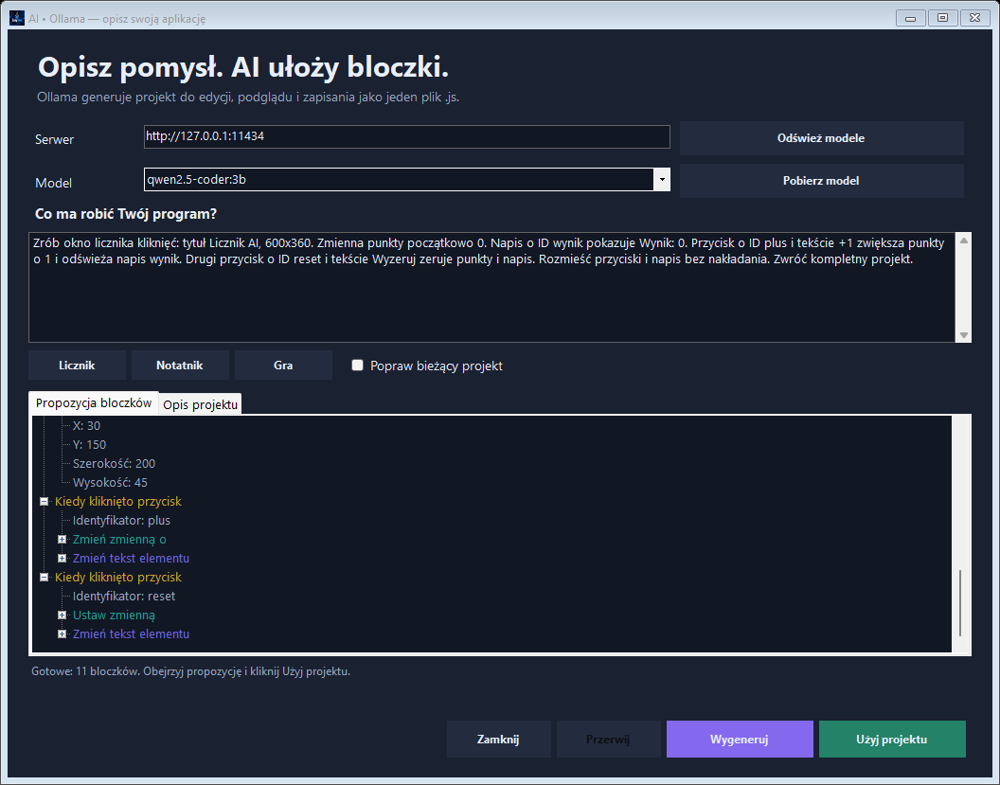
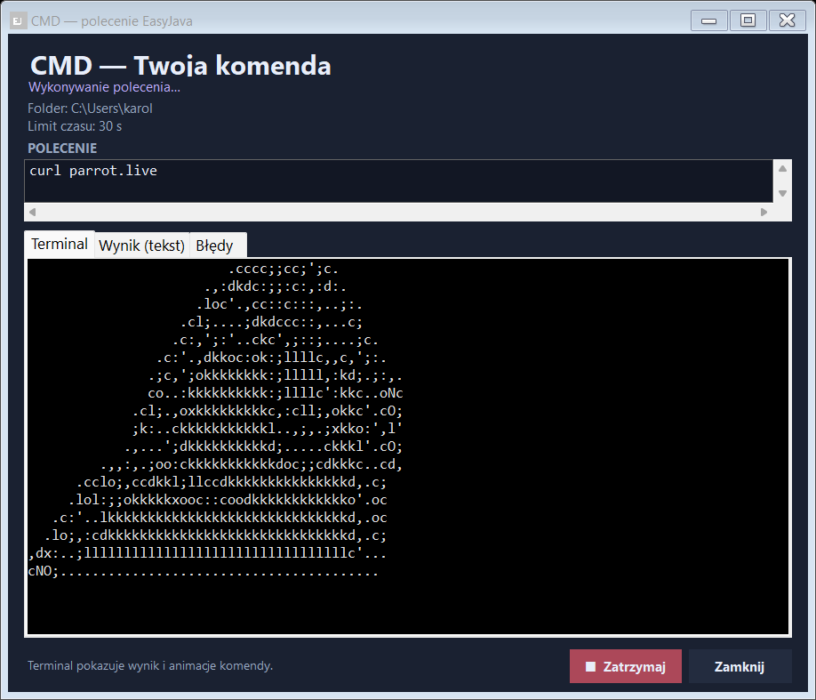
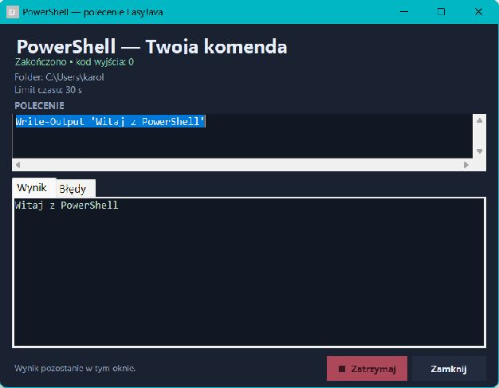
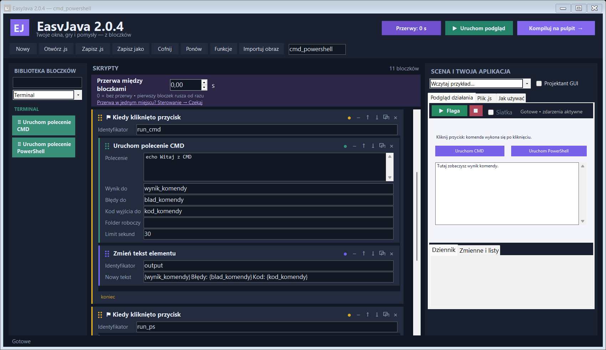

<p align="center">
  
</p>

<h1 align="center">EasyJava</h1>
<p align="center"><strong>Twój pomysł. Twoje bloczki. Twoja aplikacja.</strong></p>
<p align="center">Twórz okna, animacje i małe gry w Windows — z podglądem na żywo i jednym plikiem <code>.js</code>.</p>

<p align="center">
  
  
  
  
</p>

<p align="center">
  <a href="https://github.com/bajojajo214/easyjava/releases/latest/download/EasyJava-Setup.exe"><strong>⬇ Pobierz instalator EasyJava</strong></a>
  &nbsp; · &nbsp;
  <a href="https://github.com/bajojajo214/easyjava/raw/refs/heads/main/download/EasyJava-Windows.zip">Pobierz paczkę z przykładami</a>
  &nbsp; · &nbsp;
  <a href="docs/Instrukcja.txt">Instrukcja po polsku</a>
</p>

Chcesz zrobić własną aplikację z przyciskami albo grę sterowaną strzałkami? W EasyJava zaczynasz od pustego projektu, przeciągasz bloczki i od razu widzisz efekt. Możesz też opisać pomysł w **AI • Ollama**, aby model ułożył projekt za Ciebie. Gdy wszystko działa, klikasz **Kompiluj na pulpit** i uruchamiasz swój program dwuklikiem.

## Zobacz, co możesz zbudować


*Przykład wybrany ręcznie: własne okno, pole tekstowe, przycisk, suwak i pasek postępu. Normalny start aplikacji jest pusty.*

## Pobierz i zacznij

1. Pobierz **[instalator EasyJava-Setup.exe](https://github.com/bajojajo214/easyjava/releases/latest/download/EasyJava-Setup.exe)** i kliknij **Zainstaluj**. Możesz też wybrać przenośny **[easyjava.exe](https://github.com/bajojajo214/easyjava/raw/refs/heads/main/download/easyjava.exe)** lub **[paczkę ZIP](https://github.com/bajojajo214/easyjava/raw/refs/heads/main/download/EasyJava-Windows.zip)**.
2. Uruchom EasyJava ze skrótu na pulpicie albo plik `easyjava.exe`. Dostaniesz **pusty nowy projekt**.
3. **Chwyć bloczek, przeciągnij go i upuść** w skryptach. Samo kliknięcie lub dwuklik niczego nie dodaje.
4. Kliknij **Uruchom podgląd** lub naciśnij **F5**.
5. Kliknij **Kompiluj na pulpit**. Gotowe — masz własny program!

Ręczne tworzenie projektów działa offline i nie wymaga logowania. Potrzebujesz 64-bitowego Windows z .NET Framework 4.5 lub nowszym; uruchamianie wyeksportowanych projektów korzysta także z Windows Script Host. Opcjonalny generator AI wymaga osobno uruchomionej Ollamy i pobranego modelu.

Bezpośrednia kopia aplikacji jest również dostępna w **[download/easyjava.exe](https://github.com/bajojajo214/easyjava/raw/refs/heads/main/download/easyjava.exe)**.

**Aktualna wersja: 2.0.10.** Instalator pochodzi z najnowszego wydania, a przenośny EXE i paczka ZIP z gałęzi `main`. Numer wersji widać także w tytule okna aplikacji.

## Nowość 2.0.10: opisz program, a AI ułoży bloczki

Kliknij **AI • Ollama**, wybierz model i napisz na przykład:

> Zrób licznik kliknięć. Okno ma mieć wynik, przycisk +1 i przycisk zerowania.

Generator pokaże propozycję projektu wraz z opisem i drzewem bloczków. Kliknij **Użyj projektu**, aby wstawić ją do edytora. Potem sprawdź działanie przez **F5**, popraw dowolne bloczki i zapisz gotowy program jako jeden `.js`. Samo generowanie nie uruchamia projektu. Wstawienie propozycji można cofnąć przyciskiem **Cofnij**.

Masz już projekt? Wybierz tryb poprawiania bieżącego projektu i opisz zmianę, np. „Dodaj przycisk odejmowania punktu”. AI otrzyma jego bloczki jako kontekst; zaimportowane obrazy pozostają w projekcie. Wynik nadal można edytować ręcznie.

Potrzebujesz **[Ollamy](https://ollama.com/download)** z uruchomionym lokalnym serwerem i modelem. Domyślny adres to `http://127.0.0.1:11434`. W panelu AI odświeżysz listę modeli lub wpiszesz nazwę i klikniesz **Pobierz model**. Model pobierasz jawnie, a jego rozmiar zależy od wybranego wariantu. Nie jest potrzebny klucz API.

Domyślnie opis trafia do Ollamy na Twoim komputerze. Jeśli ustawisz adres innego serwera, trafi do niego opis, a w trybie poprawiania także bloczki bieżącego projektu. Jakość wygenerowanego programu zależy od modelu i polecenia. [Instrukcja AI i rozwiązywanie problemów](docs/Ollama.md).



Wersja 2.0.10 przeszła **103 grupy testów aplikacji bez błędów**. Sprawdzono także prawdziwy model `qwen2.5-coder:3b`: utworzenie licznika, dodanie przycisku +10, działanie przycisków i uruchomienie zapisanego `.js`. [Pełny raport i zakres testów](docs/Raport-testow.txt).

## Nowość 2.0.9: instalator EXE i nowa ikona

**[Pobierz instalator EasyJava-Setup.exe](https://github.com/bajojajo214/easyjava/releases/latest/download/EasyJava-Setup.exe)**, uruchom go i kliknij **Zainstaluj**. Domyślny folder to `C:\Program Files\EasyJava`. Instalator tworzy skrót **EasyJava** na pulpicie i w menu Start. Aplikację usuniesz przez **Ustawienia Windows → Aplikacje → EasyJava → Odinstaluj**.

Nowa ikona jest osadzona w aplikacji i instalatorze oraz używana przez skróty. Instalacja działa offline i korzysta z Windows Installer. Zapis do Program Files wymaga standardowego potwierdzenia Windows. Obsługiwany jest 64-bitowy Windows z .NET Framework 4.5 lub nowszym.

Wersja przenośna `easyjava.exe` i paczka ZIP pozostają dostępne. Projekty nadal zapisują się jako pojedyncze `.js`; instalator nie zmienia skojarzenia plików `.js`. Odinstalowanie usuwa pliki zainstalowanej aplikacji i jej skróty, zachowując osobne projekty oraz ustawienia i kopie w profilu użytkownika.

## Poprawka 2.0.8: zapis TXT podczas działającej komendy

Masz `curl parrot.live`, a za nim **Zapisz plik tekstowy**? Papuga nadaje bez końca. Przy ustawieniu **Czekaj** następny bloczek nie ruszy; Stop lub limit przerywa taki skrypt.

W bloczku CMD/PowerShell ustaw teraz **Działanie → W tle**. Okno nadal pokazuje animację, a następne bloczki, np. zapis `{pulpit}\notatka.txt`, wykonują się od razu. Wynik komendy trafia do zmiennych po jej zakończeniu. Zatrzymanie okna komendy lub jej limit kończy komendę w tle; inne zdarzenia nadal działają. Globalny Stop i zamknięcie aplikacji kończą aktywne komendy. **Czekaj** pozostaje ustawieniem domyślnym i zachowuje działanie wcześniejszych projektów.

Zapis TXT obsługuje teraz wygodne pole na wiele wierszy i pokazuje potwierdzenie ze ścieżką w dzienniku. Przykład **Papuga: curl parrot.live** korzysta z trybu w tle.

Sprawdzono **87 grup testów bez błędów**, w tym wszystkie **102 bloczki / 12 kategorii**, rzeczywisty samodzielny `.js` zapisujący TXT podczas aktywnej komendy oraz prawdziwe `curl parrot.live` równocześnie z zapisem UTF-8. [Raport i ograniczenia testów](docs/Raport-testow.txt).

**Starszy `.js` otwórz i zapisz ponownie w 2.0.8**, aby osadzić nowy silnik oraz ustawienie Działanie.

## Poprawka 2.0.7: komendy i zapis TXT po kompilacji

Przeciągnięcie nowego bloczka **CMD**, **PowerShell** lub **Pliki** włącza jego kategorię. Jeśli starszy projekt ma wyłączone kategorie używane przez bloczki, nad skryptami pojawi się przycisk **Włącz pomijane kategorie**. Możesz nadal wyłączać kategorie w **Funkcjach** oraz pojedyncze bloczki przyciskiem ●. Gotowy program wyświetla w dzienniku informację o pomijanych kategoriach.

W bloczku **Zapisz plik tekstowy** podaj np. **`{pulpit}\notatka.txt`**. Sama ścieżka folderu nie jest nazwą pliku. Nazwa `notatka.txt` bez folderu zapisuje **obok projektu `.js`**; w niezapisanym podglądzie — na pulpicie. Dostępne są także `{dokumenty}`, `{folder_projektu}` i ścieżki z `%USERPROFILE%`. Pusty folder roboczy CMD/PowerShell oznacza teraz ten sam folder projektu. Okno wyboru zapisu dopisuje `.txt` i nie zmienia folderu całej aplikacji.

Sprawdzono wykonanie **102/102 bloczków z 12 kategorii**, a osobny test uruchamia prawdziwy samodzielny `.js` przez Windows Script Host i wykonuje CMD, PowerShell oraz zapis/dopisanie/odczyt TXT UTF-8. Ten test nie używa `--smoke`. Zakres i ograniczenia sprawdzeń opisuje [raport testów](docs/Raport-testow.txt), a [lista bloczków](docs/Pokrycie-bloczkow.txt) dokumentuje pokrycie.

**Starszy plik `.js` otwórz w EasyJava 2.0.8, włącz pomijane kategorie i zapisz lub skompiluj ponownie.** Plik zawiera własną kopię silnika, więc sama aktualizacja edytora nie aktualizuje wcześniej utworzonych programów.

## Poprawka 2.0.6: animacja z komendy w oknie GUI

Wpisz **`curl parrot.live`** w bloczku CMD lub PowerShell. W wyskakującym oknie otwiera się zakładka **Terminal**, która pokazuje wynik komendy na żywo: kolory, zmiany klatek i przesuwanie kursora. Sekwencje sterujące ANSI są interpretowane zamiast pojawiać się jako niezrozumiałe znaki. Nie trzeba dodawać osobnego bloczka wyświetlania tekstu.



Polecenie `curl parrot.live` wymaga połączenia z internetem i działa do zatrzymania lub osiągnięcia limitu czasu. Domyślny limit to **30 sekund**; zmienisz go w bloczku. **Zatrzymaj** i zamknięcie aktywnego okna nadal przerywają komendę. Możesz też jawnie wpisać `curl.exe parrot.live`, aby użyć programu curl systemu Windows.

Zakładki **Wynik** i **Błędy** pozostają dostępne do odczytania tekstu. Kolorowy ekran działa w podglądzie oraz w gotowym `.js`. Starszy plik `.js` otwórz w **EasyJava 2.0.8** i zapisz ponownie, aby zawierał poprawiony silnik.

W przykładzie **CMD i PowerShell** kliknij **Papuga: curl parrot.live**, aby od razu zobaczyć animację w oknie.

## Nowość w 2.0.5: komenda w wyskakującym oknie



Uruchom bloczek **CMD** lub **PowerShell**, a zobaczysz osobne okno GUI z treścią polecenia, folderem roboczym i limitem czasu. Zakładki **Wynik** i **Błędy** pokazują odbierany tekst na żywo. Przyciskiem **Zatrzymaj** przerwiesz aktywną komendę. Zamknięcie okna podczas działania również ją przerywa.

Po zakończeniu okno pozostaje otwarte, aby dało się przeczytać wynik i kod zakończenia. Funkcja działa zarówno w podglądzie edytora, jak i w gotowym pliku `.js`. Wynik nadal trafia do zmiennych wskazanych w bloczku. Do uruchomienia użyj **Funkcje → Terminal**; możesz też wybrać przykład **CMD i PowerShell**.

Starszy wyeksportowany plik `.js` otwórz w EasyJava 2.0.8 i zapisz ponownie, aby zawierał nowy silnik z oknem komendy i obsługą animacji terminala.

## Nowość w 2.0.4: CMD i PowerShell z bloczków



W **Funkcje → Terminal** włącz nową kategorię w swoim projekcie. Następnie przeciągnij **Uruchom polecenie CMD** albo **Uruchom polecenie PowerShell** do skryptu. Terminal jest domyślnie wyłączony także we wcześniejszych projektach; jego ustawienie zapisuje się w `.js`.

Każdy bloczek ma pole polecenia oraz osobne pola nazw zmiennych na **wynik**, **błędy** i **kod zakończenia**. Możesz też wybrać folder roboczy — puste pole oznacza folder projektu — oraz limit czasu od **1 do 3600 sekund**, domyślnie **30 s**. Polecenie pokazuje się w osobnym oknie GUI EasyJava, a następny bloczek czeka na jego zakończenie. **Stop** i przekroczenie czasu kończą uruchomione polecenie wraz z procesami potomnymi.

Prosty przykład: w bloczku CMD wpisz `echo Witaj z CMD`, a jako zmienną wyniku pozostaw `wynik_komendy`. Za nim przeciągnij **Powiedz / pokaż tekst** i wpisz `{wynik_komendy}`. W PowerShell możesz użyć `Write-Output 'Witaj z PowerShell'`. Wynik wykorzystasz też w napisie własnego GUI. Na liście **Wczytaj przykład** znajdziesz gotowy projekt **CMD i PowerShell** z dwoma przyciskami; polecenia wykonują się dopiero po kliknięciu.

Jednowierszowe polecenia CMD używają składni wiersza poleceń. Kilka wierszy CMD jest wykonywanych jako skrypt `.cmd` w UTF-8 (w pętlach stosuj `%%i`). Pole polecenia zachowuje składnię PowerShell, w tym cudzysłowy i klamry. W tym polu EasyJava nie podstawia swoich zmiennych `{nazwa}`. Standardowe wyjście i błędy są odbierane oddzielnie, do miliona znaków na każdy strumień. Funkcja działa w podglądzie oraz w wyeksportowanym `.js`; tryb testowy `--smoke` pomija uruchamianie poleceń.

Po normalnym zakończeniu komendy aplikacje uruchomione przez `start` lub `Start-Process` mogą pozostać otwarte; późniejszy Stop nie zamyka już odłączonych aplikacji. Wyjście CMD i PowerShell jest odbierane w UTF-8, aby zachować polskie znaki i wynik zewnętrznych narzędzi, takich jak curl.

Polecenia działają z uprawnieniami użytkownika i mogą zmieniać pliki oraz ustawienia. EasyJava nie podnosi uprawnień i nie zmienia zasad wykonywania skryptów PowerShell.

## Poprawka 2.0.3: przerwy zawsze pod ręką

Bezpośrednio nad bloczkami w obszarze **SKRYPTY** znajdziesz wyróżniony panel **Przerwa między bloczkami**. Wpisz liczbę sekund w widocznym polu — ustawienie zmienia się od razu. Możesz wybrać czas od **0 do 3600 sekund**, z dokładnością do dwóch miejsc po przecinku. **0** wyłącza dodatkowe przerwy.


Przycisk **Przerwy: 0 s** na górnym pasku otwiera także okno **Przerwy między bloczkami** z gotowymi wartościami **0 / 0,1 / 0,5 / 1 / 2 / 5 s**. W tym oknie potwierdź wybór przyciskiem **Zastosuj**. Po zmianie uruchom podgląd ponownie, a następnie zapisz `.js`, aby zachować ustawienie.

Pierwsze polecenie w skrypcie rusza od razu. Następne czeka wybrany czas od zakończenia poprzedniego. Ustawienie zapisuje się w projekcie `.js` i działa tak samo w podglądzie oraz gotowym programie.

Potrzebujesz przerwy tylko w jednym miejscu? Przeciągnij bloczek **Czekaj** z kategorii **Sterowanie** pomiędzy dwa polecenia i wpisz w nim czas. Znajdziesz go też, wpisując w wyszukiwarce **przerwa**, **pauza** lub **odstęp**. Jego czas dolicza się do przerwy ustawionej dla całego projektu. Dla samej pojedynczej pauzy pozostaw pole nad skryptami na **0**.

Pętle i warunki zachowują odstępy pomiędzy poleceniami w środku, bez podwójnych pauz. Komentarze i wyłączone bloczki nie dodają czasu. Każde nowe zdarzenie zaczyna od razu i ma własne odstępy, a **Stop** przerywa czekanie. Szczegóły wcześniejszej funkcji odstępów z wersji 2.0.2 znajdziesz w [historii zmian](CHANGELOG.md).

## Poprawka 2.0.1: chwyć i upuść

Bloczki z biblioteki dodajesz **wyłącznie przez przeciąganie i upuszczanie**. Pod kursorem widać przenoszony bloczek, a podświetlenie wskazuje miejsce wstawienia. Możesz upuszczać między kartami oraz do wnętrza pętli, warunku lub zdarzenia. Upuszczenie poza skryptami niczego nie zmienia.

Poprawka zapewnia też unikalne nazwy kolejnych elementów GUI oraz blokuje wkładanie deklaracji zdarzeń do wnętrza innych skryptów. [Lista zmian](CHANGELOG.md).

## Co jest w środku?

| Funkcja | Co z nią zrobisz |
| --- | --- |
| **102 bloczki w 12 kategoriach** | Połączysz zdarzenia, ruch, wygląd, logikę, obliczenia i wiele więcej. |
| **AI z Ollamą** | Opiszesz pomysł po polsku, wygenerujesz edytowalne bloczki lub zaproponujesz zmianę w bieżącym projekcie. |
| **Własne GUI** | Dodasz napisy, przyciski, pola tekstowe, listy, suwaki, obrazy i paski postępu. |
| **Projektant GUI** | Ustawisz elementy okna myszą; ich pozycje zapiszą się w bloczkach. |
| **Podgląd działania** | Sprawdzisz program wewnątrz edytora, z prawdziwymi kliknięciami i zdarzeniami. |
| **Odstępy między bloczkami** | Wybierzesz tempo wykonywania poleceń, zapisane także w gotowym `.js`. |
| **Scena i duszki** | Zrobisz ruch, obroty, płynne loty, odbicia, kostiumy i dymki. |
| **Klawiatura i mysz** | Dodasz sterowanie strzałkami, kliknięcia duszka i pomiar pozycji myszy. |
| **Zmienne, listy i wyrażenia** | Zapiszesz wyniki, policzysz punkty i użyjesz własnych danych. |
| **Pisak i dźwięki** | Narysujesz animowane wzory i dodasz proste efekty dźwiękowe. |
| **Odczyt i zapis plików** | Zbudujesz np. własny notatnik. Tę kategorię włączasz w oknie Funkcje. |
| **CMD i PowerShell** | Zobaczysz polecenie w osobnym oknie GUI, odbierzesz tekst na żywo, błędy i kod zakończenia. Włącz kategorię Terminal w Funkcjach. |
| **Włączanie i wyłączanie** | Wyłączysz pojedynczy bloczek albo całą grupę funkcji. |
| **Cofanie, wyszukiwanie, zwijanie** | Łatwiej uporządkujesz większy projekt. |
| **Samodzielny plik `.js`** | Zapiszesz gotowy program razem z bloczkami i obrazami. |

## Jeden plik — program i projekt

**Zapisz .js** zachowuje układ bloczków w tym samym pliku, który uruchamia gotową aplikację. Przyciskiem **Otwórz .js** wrócisz do edycji. Nowe projekty nie wymagają plików `.easyjava`.

**Kompiluj na pulpit** tworzy wyłącznie `mojprojekt.js` — bez dodatkowych skrótów `.lnk`. Nazwa pliku zależy od nazwy projektu. Node.js nie jest potrzebny. Wygenerowany `.js` zawiera osadzony silnik okienkowy i nie wymaga pliku edytora obok siebie.

Uruchom program dwuklikiem w `.js`, gdy Windows przypisuje to rozszerzenie do Windows Script Host. Przycisk **Otwórz program** po kompilacji również uruchamia ten plik przez systemowy `wscript.exe`.

## Zacznij od przykładu, kiedy chcesz

Aplikacja **zawsze startuje od zera**. Gotowe projekty wybierasz samodzielnie z listy **Wczytaj przykład**:

- **Panel GUI** — pole tekstowe, powitanie, przycisk, suwak i pole wyboru.
- **Licznik kliknięć** — zdobywanie punktów i zerowanie wyniku.
- **Sterowanie duszkiem** — strzałki, spacja i reagowanie na kliknięcie.
- **Rysujący robot** — pisak i animowany wzór z pętli w pętli.
- **Złap gwiazdę** — prosta gra ze zbieraniem punktów.
- **Lista zadań** — dopisywanie elementów do własnej listy.
- **CMD i PowerShell** — przyciski uruchamiające polecenia oraz pole z wynikiem.
- **Notatnik** — okno edytora tekstowego z otwieraniem i zapisem plików.


## Małe wskazówki, duże możliwości

- `{punkty}` wstawia wartość zmiennej do tekstu, np. `Wynik: {punkty}`. Pole polecenia CMD/PowerShell zachowuje własną składnię i nie podstawia tych zmiennych.
- `=punkty * 2 + 1` oblicza wyrażenie.
- `●` w nagłówku bloczka pozwala go wyłączyć bez usuwania.
- **Funkcje** wyłącza całe kategorie. Wyłączone bloczki są pomijane także w wyeksportowanym programie.
- **Importuj obraz** osadza grafikę w projekcie — możesz użyć jej jako elementu GUI lub kostiumu duszka.
- **Dziennik** pokazuje komunikaty i błędy, a **Zmienne i listy** pokazuje bieżące dane.

## Skróty

| Skrót | Działanie |
| --- | --- |
| `F5` | Uruchom podgląd |
| `Shift+F5` | Zatrzymaj podgląd |
| `Ctrl+Enter` | Kompiluj na pulpit |
| `Ctrl+S` | Zapisz `.js` |
| `Ctrl+Shift+S` | Zapisz jako |
| `Ctrl+O` | Otwórz projekt |
| `Ctrl+N` | Nowy pusty projekt |

## Źródła i budowanie

Kod aplikacji znajduje się w [`src/`](src). Edytor, podgląd i odtwarzacz projektów są napisane w C# i Windows Forms. Budowanie korzysta z kompilatora dołączonego do .NET Framework:

```powershell
.\src\Build-EasyJava.ps1
```

Gotowy plik pojawi się jako `src/easyjava.exe`. Bezpośrednie uruchomienie `easyjava.exe --selftest <folder>` wykonuje testy aplikacji i zapisuje raport w podanym folderze. Testy obejmują GUI, zdarzenia, pętle, obliczenia, listy, pisak, grę, wyłączanie funkcji i uruchamianie `.js` przez prawdziwy Windows Script Host. Zobacz [raport z wydania](docs/Raport-testow.txt).

Przy zastępowaniu zapisanego projektu poprzednia wersja trafia do `%LOCALAPPDATA%\EasyJava\Kopie`.

## Zakres projektu

EasyJava to własny edytor inspirowany programowaniem bloczkowym. Tworzy aplikacje Windows i nie importuje projektów Scratch `.sb3`. Nazwa aplikacji to EasyJava, natomiast format projektów to `.js` — nie jest to kompilator języka Java.

Masz pomysł na nowy bloczek albo znalazłeś błąd? **[Dodaj zgłoszenie](https://github.com/bajojajo214/easyjava/issues/new)** i opisz, co chcesz zbudować.

**Pobierz aplikację, dodaj pierwszy bloczek i sprawdź, co wymyślisz.**
